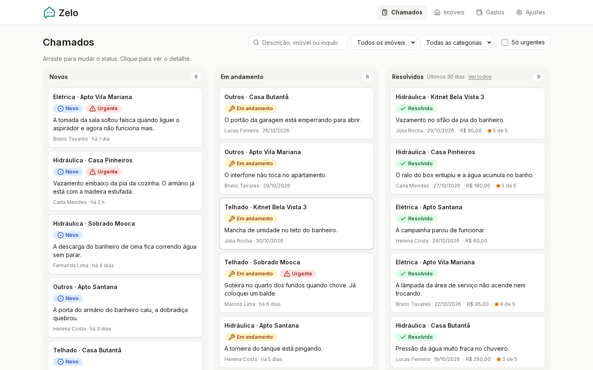
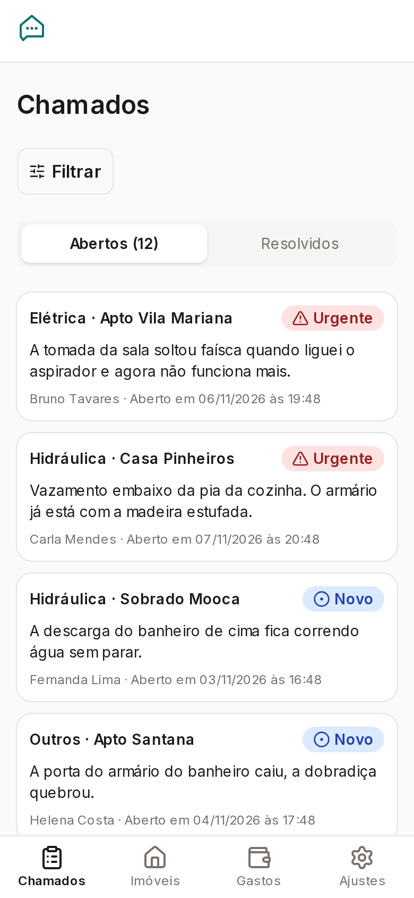
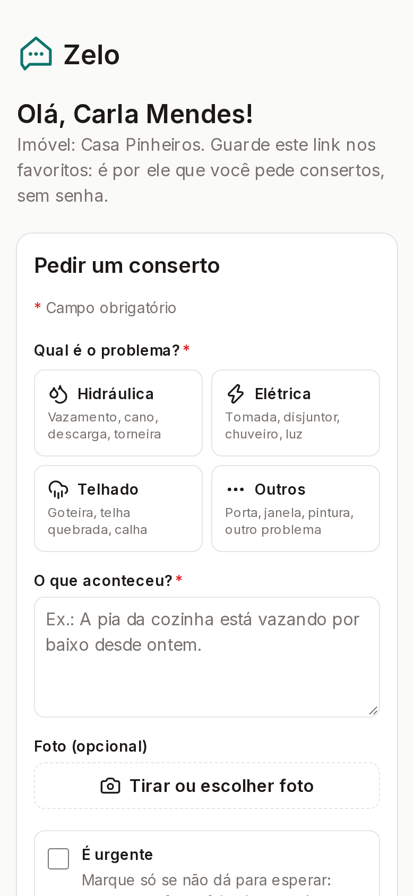
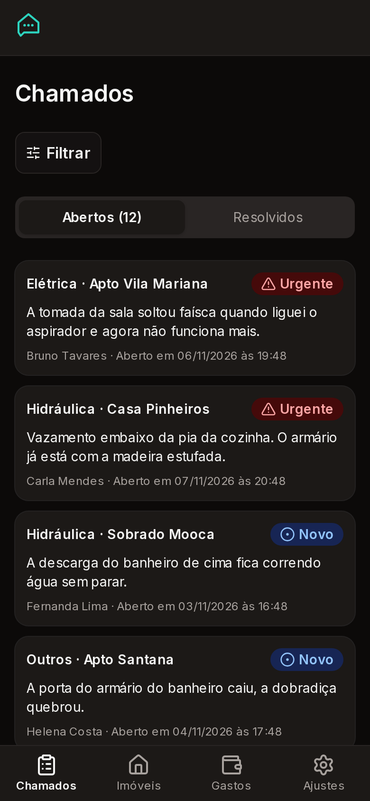
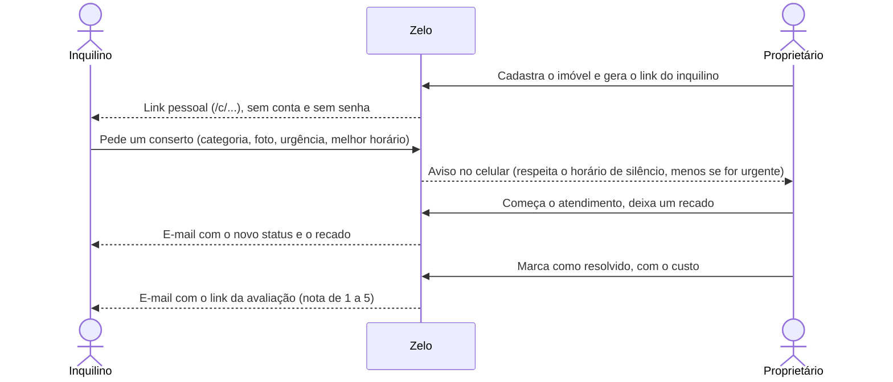
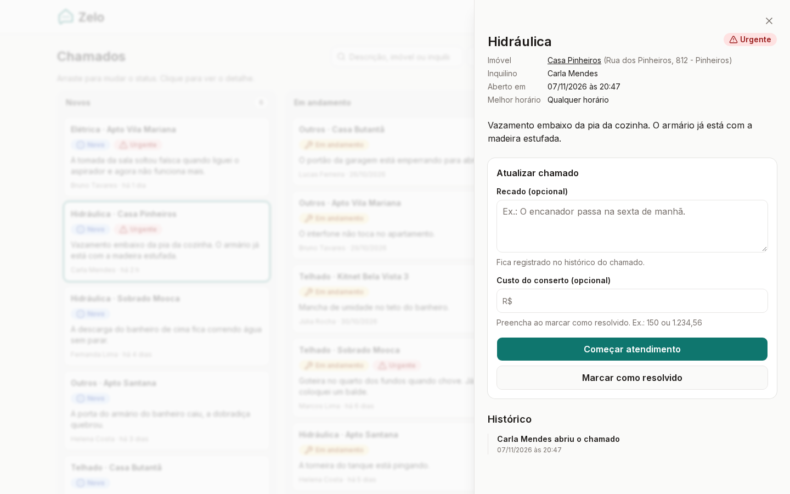
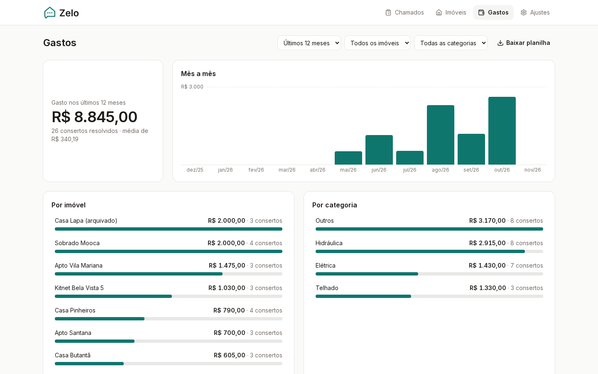

# Zelo

**Pedidos de conserto entre o pequeno proprietário e seus inquilinos, num lugar só.**

Quem aluga 2 a 15 imóveis costuma receber pedido de conserto por WhatsApp, ligação e recado, e perde o fio: o que já foi resolvido, quanto custou, quem estava esperando. No Zelo, o inquilino abre o pedido por um link pessoal, sem cadastro nem senha. O proprietário acompanha tudo num quadro, avisa o andamento e fica com o histórico de gastos de cada imóvel.

**[Abrir a demonstração →](https://zelo-demo-five.vercel.app/entrar)**: toque em **Entrar na demonstração**. Você entra numa conta só sua, já com imóveis, inquilinos e chamados de exemplo, e pode mexer à vontade. A conta é apagada depois de 24 horas.



<p align="center">
  
  
  
</p>

## Como funciona



### Para o proprietário

- **Entrar sem senha:** código de 6 números por e-mail. No primeiro acesso, o app pede só o nome.
- **Chamados:** lista com Abertos e Resolvidos no celular e quadro arrastável no computador (Novos, Em andamento, Resolvidos), que também funciona pelo teclado. Filtros por texto, imóvel, categoria e "só urgentes".
- **Detalhe do chamado:** foto, recado ao inquilino, custo do conserto e histórico completo.
- **Imóveis e inquilinos:** endereço com preenchimento pelo CEP, foto do imóvel, link do inquilino (gerar outro, desativar, ver o último acesso). Imóvel com histórico é arquivado em vez de apagado.
- **Gastos:** total, média e gráfico mês a mês, divisão por imóvel e por categoria, filtros de período e planilha para o Excel.
- **Avisos no celular (Web Push)**, com horário de silêncio ajustável (padrão das 21h às 8h).
- **App instalável (PWA):** abre como um app, tem uma tela própria quando fica sem internet e uma dica de instalação no Android e no iPhone.
- **Modo escuro**, que segue o celular ou é escolhido em Ajustes.

### Para o inquilino

- Um link pessoal, sem cadastro: abre o pedido, acompanha "Seus pedidos" e avalia o atendimento.
- A foto é reduzida no próprio celular antes de enviar, e os dados de localização são removidos.
- "Perdi meu link": recebe o link de novo por e-mail.

<p align="center">
  
  
</p>

## Tecnologias

| Camada | O que usa |
|---|---|
| App | Next.js 16 (App Router, Server Actions, Cache Components), React 19, TypeScript |
| Interface | Tailwind CSS 4, shadcn/ui, dnd-kit (arrastar), next-themes |
| Dados | Supabase: Postgres com RLS, Auth (código por e-mail), Storage, Edge Functions (Deno), pg_cron, pg_net e Vault |
| Avisos | Web Push (VAPID) e e-mails por SMTP, Resend ou Mailpit (local) |
| Validação | Zod 4 |
| Testes | Vitest (unitários), pgTAP (banco) e Playwright (navegador, no celular e no computador) |
| Ambiente | Docker: Node 24, pnpm e Supabase CLI só dentro do container |

## Decisões de projeto

- **As regras ficam no banco.** Mudar status, excluir ou arquivar imóvel e decidir quando avisar são funções do Postgres com testes em pgTAP. Assim, a mesma regra vale para o app, para a Edge Function e para qualquer acesso futuro.
- **RLS em todas as tabelas.** O proprietário só enxerga os próprios imóveis, chamados e fotos. A chave secreta (service role) só é usada no servidor.
- **O link do inquilino funciona como senha.**
  - O banco guarda apenas o hash do token, e o link aparece uma única vez.
  - A página do inquilino não manda o endereço da página para outros sites (sem Referer) e pede para não ser indexada por buscadores.
  - O "Perdi meu link" sempre responde igual, para não revelar quais e-mails existem.
- **Os avisos não se perdem.**
  - Um chamado novo cria a notificação numa fila.
  - Se já está na hora de avisar, o banco chama a Edge Function no mesmo momento (pg_net). O pg_cron passa a cada 5 minutos para entregar o que esperava o fim do horário de silêncio e para tentar de novo o que falhou.
  - O horário de silêncio é calculado no fuso de São Paulo.
- **Pensado primeiro para o celular.** Botões grandes e telas em pt-BR. Os status sempre têm cor, ícone e texto juntos, e o contraste segue a WCAG (com teste automático).
- **Cabeçalhos de segurança** em todas as respostas: proteção contra o app ser aberto dentro de outro site (clickjacking), HSTS, `nosniff` e `Permissions-Policy`.

## Rodando no seu computador

Só precisa de **Docker** no Linux: o container usa a rede e o Docker do próprio computador para subir o Supabase local.

```bash
make build                    # imagem de desenvolvimento (uma vez)
make install                  # dependências
make db-start                 # Supabase local (Postgres, Auth, Storage, Studio, Mailpit)
make db-status                # mostra as URLs e as chaves locais
cp .env.example .env.local    # preencha com as chaves do db-status
make avisos-config            # liga o banco à função de avisos
make seed                     # dados de exemplo (opcional)
make dev                      # http://localhost:3000
```

| Endereço | O que é |
|---|---|
| http://localhost:3000 | App (saúde em `/api/health`) |
| http://localhost:54323 | Supabase Studio |
| http://localhost:54324 | Mailpit: os e-mails, inclusive o código de login |

Com `make seed`, entre como `marta@zelo.local` (8 imóveis e 38 chamados) ou `jorge@zelo.local`. O código de login chega no Mailpit. Para ver o lado do inquilino, use o link fixo da Carla: http://localhost:3000/c/demo-casa-pinheiros-carla000000000000000000. Os outros links fixos estão no topo de `supabase/seed.sql`.

Se a página ficar recarregando sozinha ou o CSS parar de mudar, o cache do Next ficou velho: `make dev-limpar`. Todos os atalhos, com uma linha explicando cada um, estão no `Makefile`.

## Testes

```bash
make test       # unitários (Vitest): Server Actions, proxy, regras de tela
make test-db    # banco (pgTAP): RLS, gatilhos e funções (precisa do db-start)
make test-e2e   # navegador (Playwright): celular e computador (*.pc.spec.ts)
make test-all   # lint, tipos e todos os testes
```

Hoje são 259 testes unitários, 115 do banco e 49 no navegador. Os testes de navegador:
- leem o código de login no Mailpit;
- usam um e-mail `e2e-...@zelo.test` novo a cada execução;
- apagam tudo o que criaram ao terminar.

Com `E2E_BASE_URL`, rodam contra qualquer endereço, por exemplo a imagem de produção ou a demonstração.

## Estrutura

```
src/
  app/            telas e rotas (App Router)
    (app)/          área do proprietário: chamados, imóveis, gastos, ajustes
    c/[token]/      página do inquilino
    avaliar/        avaliação do atendimento (link de uso único)
    entrar/         login por código e botão da demonstração
    api/            saúde e limpeza da demonstração
  components/     componentes compartilhados (ui/ = shadcn)
  lib/            regras por assunto (chamados, imoveis, gastos, push, email...)
  proxy.ts        sessão e rotas protegidas
supabase/
  migrations/     esquema, RLS e funções (única forma de mudar o banco)
  functions/      Edge Function entregar-notificacoes (push e e-mails)
  tests/database/ testes pgTAP
  templates/      e-mail do código de acesso
  seed.sql        dados de exemplo
e2e/              testes Playwright
docs/             estado do projeto e imagens deste README
```

## Guia de operação

<details>
<summary><strong>Banco de dados</strong></summary>

As migrações em `supabase/migrations` são a única forma de mudar o esquema. Nada é alterado pelo painel.

```bash
make db-new nome=descricao   # cria uma migração nova
make db-migrate              # aplica só as novas (mantém os dados)
make db-reset                # recria do zero (APAGA os dados locais)
make db-types                # regenera src/lib/supabase/database.types.ts
```

Na nuvem: `supabase db push` com o projeto ligado (`supabase link`).
</details>

<details>
<summary><strong>E-mails</strong></summary>

Os e-mails do app e da função de avisos ("Perdi meu link", status ao inquilino) saem pelo primeiro caminho configurado:

1. SMTP: `SMTP_HOST`, `SMTP_PORT`, `SMTP_USER` e `SMTP_PASS`. Por exemplo, o Gmail com senha de app na porta 465.
2. A API do Resend: `RESEND_API_KEY`.
3. No local, o Mailpit: `MAILPIT_URL`.

O remetente vem de `EMAIL_FROM`.

O e-mail do código de login é enviado pelo próprio Supabase Auth, com o modelo `supabase/templates/codigo-acesso.html`. Na nuvem, configure um SMTP em Authentication → SMTP Settings, porque o SMTP padrão do Supabase envia poucos e-mails e não aceita modelo próprio. Depois confira se o `site_url` aponta para o endereço publicado.
</details>

<details>
<summary><strong>Avisos (Web Push)</strong></summary>

- Segredos locais ficam em `supabase/functions/.env` (modelo em `supabase/functions/.env.example`). A chave pública vai em `NEXT_PUBLIC_VAPID_PUBLIC_KEY` no `.env.local`.
- `make avisos-config` grava no Vault a URL das funções e o segredo (o `make db-reset` já faz isso sozinho).
- Uma função nova em `supabase/functions` só aparece depois de `make db-stop && make db-start`.
- Para testar no computador: Chrome → Ajustes → "Ligar avisos neste aparelho" → "Enviar aviso de teste". No celular, os avisos só funcionam com HTTPS. No iPhone, só com o Zelo na Tela de Início.

Na nuvem:

1. `supabase secrets set VAPID_PUBLIC_KEY=... VAPID_PRIVATE_KEY=... VAPID_SUBJECT=mailto:... NOTIFICACOES_SEGREDO=... APP_URL=https://... EMAIL_FROM=...`, mais o SMTP ou `RESEND_API_KEY`. A lista completa está em `supabase/functions/.env.example`.
2. `supabase functions deploy entregar-notificacoes`.
3. No SQL Editor, rode `supabase/avisos-config.sql` com a URL das funções e o mesmo `NOTIFICACOES_SEGREDO`.
4. Na Vercel, `NEXT_PUBLIC_VAPID_PUBLIC_KEY` com a mesma chave pública.
</details>

<details>
<summary><strong>Demonstração na Vercel</strong></summary>

- **Onde roda:** Vercel Hobby (projeto `zelo-demo`) e Supabase Cloud grátis, na região de São Paulo.
- **Credenciais:** ficam em `.env.deploy`, fora do Git. O `.vercelignore` impede que esse arquivo vá junto no deploy.
- **Supabase grátis:** o projeto pausa depois de 7 dias sem uso. Para reativar, use o painel.
- **Botão "Entrar na demonstração":** só existe com `DEMONSTRACAO=ligada`.
  - Cada clique cria uma conta `visitante-<aleatório>@demo.zelo.test`, preenchida pela função `criar_dados_demonstracao`, a mesma do `seed.sql`.
  - No máximo 100 contas novas por hora.
- **Limpeza diária:** todo dia às 4h, o Vercel Cron (definido no `vercel.json`) chama `/api/demonstracao/limpar` com o `CRON_SECRET`. A rota apaga as contas de visitante com mais de 24 horas e as fotos delas.
- **Novo deploy:** `vercel deploy --prod` de dentro do container.
</details>

<details>
<summary><strong>Imagem de produção (Docker)</strong></summary>

```bash
make prod   # builda o Dockerfile (output standalone) e sobe em http://localhost:3000
```

As variáveis `NEXT_PUBLIC_*` entram no build. Cada uma nova precisa de um `ARG` no Dockerfile e de uma entrada em `args` no docker-compose. As demais variáveis são lidas quando o app roda.
</details>
